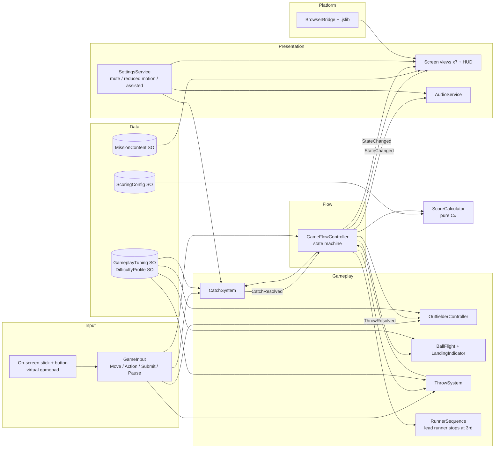
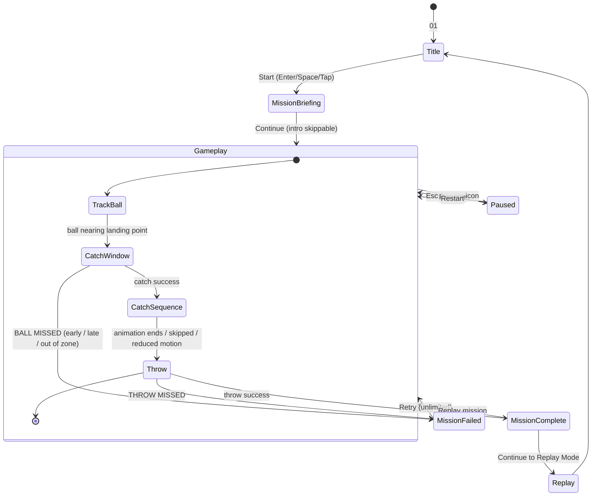

# 01 — Confirmed Scope & Unity Architecture

**Milestone 1 deliverable.** Status: draft for client review (2026-11-17).
**Engine change:** the GDD specifies Godot 4 / GDScript. This project uses **Unity 6.3 LTS (6000.3.9f1) + C#** instead. Where the GDD says "Godot project" (deliverables, AC-16), read "Unity project".

---

## 1. What we are building

A 3–5 minute, browser-playable 2D pixel-art arcade recreation of Willie Mays's over-the-shoulder catch (Game 1, 1954 World Series, Polo Grounds, 29 Sep 1954) for the Fastball Fuel Coffee Company website (Wix).

**Core loop:** *Track the ball → make the catch → make the throw.* Fail = instant retry (never an alternative history). Success = score, rank, and a historical replay screen.

### 1.1 Version 1 scope (confirmed from GDD)

| Included | Not included |
|---|---|
| 1 playable character, 1 field, 1 mission | Full games / innings simulation |
| 3 mechanics: movement, catch timing, throw timing | Multiplayer, accounts, leaderboards, backend |
| 7 screens/states (Title, Mission, Gameplay, Catch Sequence, Failed, Complete, Replay) | Character customisation, more players/stadiums/missions |
| Scoring (max 1,000) + ranks ROOKIE / ALL-STAR / LEGENDARY | Online achievements, e-commerce |
| Default difficulty + labelled **Assisted mode** (wider catch window) | 3D, branching narrative |
| Keyboard + touch controls, pause, restart, mute, reduced motion | Personal data collection of any kind |
| Original pixel art + audio, WebGL build, Wix embed (or documented fallback) | |

### 1.2 Decisions needed from the client (blocking later milestones, not M1)

| # | Question | Needed by |
|---|---|---|
| Q1 | **Name & likeness:** may we use "Willie Mays", "Vic Wertz", "Larry Doby", "Giants", "Cleveland", "Polo Grounds" on screen? If not, we ship the generic "Center Fielder" variant the GDD mentions. The architecture keeps every name in one editable content asset, so either answer is cheap. | M3 |
| Q2 | Approve palette (6 core colours) **plus the 6 proposed extension colours** (skin, leather, dirt, grass shades, dusk sky) — see the art-direction sheet. | M3 |
| Q3 | Where will the build be hosted (HTTPS)? Options: Netlify / Cloudflare Pages / GitHub Pages / itch.io / the client's own server. Wix itself cannot host a Unity build. | M4 |
| Q4 | Wix editor flavour (classic Wix Editor vs Wix Studio) and the exact page URL for the embed test. | M4 |
| Q5 | URL for the "Return to museum / STORY MODE" button (Screen 07). | M4 |
| Q6 | Approve the proposed scoring formula (§6) and historical copy (M4). | M2 / M4 |

---

## 2. Architecture principles

- **One gameplay scene, one composition root.** The whole game is a single scene (`Main.unity`, created in M2). No scene loading = fastest WebGL start-up, no duplicate managers, trivial restart (reset state, not reload).
- **Small components, explicit wiring.** Dependencies are assigned in the Inspector (or by the composition root). No service locator, no static singletons for gameplay state.
- **State machine owns the flow; systems own their mechanic.** The flow controller says *what phase we're in*; Track/Catch/Throw systems decide *how the mechanic works* and report results through C# events.
- **All tuning and text is data.** ScriptableObjects hold speed, timing windows, zone sizes, score maxima, rank thresholds and every on-screen string (GDD: "adjustable without rewriting the main game systems").
- **No per-frame work unless something moves.** `Update()` only in components that genuinely animate/poll (player movement, ball flight, timing meters). Screens, scoring and audio are event-driven.
- **Platform code is isolated.** Browser specifics live behind `SayHeyDash.Platform.BrowserBridge` + one `.jslib`. Everything else is platform-agnostic.

## 3. Assemblies & namespaces

| Assembly (asmdef) | Folder | Namespace(s) | Purpose |
|---|---|---|---|
| `SayHeyDash.Runtime` | `Assets/_Project/Scripts/Runtime` | `SayHeyDash.*` (`Controls`, `Platform`, later `Flow`, `Gameplay`, `Scoring`, `UI`, `Audio`, `Settings`, `Data`) | All production code |
| `SayHeyDash.Prototype` | `Assets/_Project/Scripts/Prototype` | `SayHeyDash.Prototype` | **M1 throwaway PoC code** — delete the folder after M2 |
| `SayHeyDash.Editor` | `Assets/_Project/Scripts/Editor` | `SayHeyDash.EditorTools.*` | Build pipeline, import rules, scene generators |
| *(M2+)* `SayHeyDash.Tests.EditMode` | `Assets/_Project/Tests` | | Unit tests for scoring/state machine |

## 4. Systems map (who does what)



| System | Type | Responsibility | Milestone |
|---|---|---|---|
| `GameInput` | MonoBehaviour | Device-agnostic actions & events (**done in M1**) | M1 |
| `BrowserBridge` | static C# + `.jslib` | iframe detection, focus, touch detection, DPR, gesture-safe URL opening (**done in M1**) | M1 |
| `WebGLBuildPipeline` | Editor | Reproducible WebGL settings & build (**done in M1**) | M1 |
| `PixelArtTexturePostprocessor` | Editor | Enforces Point/16 PPU/uncompressed on new sprites (**done in M1**) | M1 |
| `GameFlowController` + `GameState` | MonoBehaviour + enum | Drives the 7 states, restart, pause | M2 |
| `OutfielderController` | MonoBehaviour | Movement within field bounds; reads `GameInput.Move` | M2 |
| `BallFlight` / `LandingIndicator` | MonoBehaviour | Scripted, deterministic arc (no randomness — GDD fairness) + shadow | M2 |
| `CatchSystem` | MonoBehaviour | Catch zone + timing window, emits `CatchResolved(result)` | M2 |
| `ThrowSystem` | MonoBehaviour | Moving accuracy meter + target zone, emits `ThrowResolved(result)` | M2 |
| `ScoreCalculator` | plain C# | Pure scoring + rank function (unit-testable) | M2 (basic) / M4 (final) |
| `RunnerSequence` | MonoBehaviour | Scripted base-runner outcome (Doby to 3rd, no run scores) | M2 basic / M4 |
| Screen views (`TitleScreenView`, ...) | MonoBehaviour per screen | Show/hide on `StateChanged`; no game logic | M3 |
| `AudioService` | MonoBehaviour | Plays cues from an `AudioCueLibrary` SO; mute | M3 / M4 |
| `SettingsService` | plain C# + PlayerPrefs | Mute, reduced motion, assisted mode (persisted, fails gracefully in partitioned iframes) | M4 |
| `ReplayDirector` | MonoBehaviour | Simplified animated replay on Screen 07 | M4 |

## 5. Game flow (the 7 required states)



Screen mapping: 01 Title · 02 MissionBriefing · 03 Gameplay (TrackBall/CatchWindow/Throw) · 04 CatchSequence · 05 MissionFailed · 06 MissionComplete · 07 Replay. Pause is an overlay, not one of the seven.

**History rule (GDD):** a failed attempt only ever shows *TRY AGAIN — BALL MISSED / THROW MISSED*. The runner outcome (lead runner holds at third, no run scores) is shown **only** on success and in the replay.

## 6. Data (ScriptableObjects) — designed now, created in M2+

| Asset | Fields (clearly named, per GDD) |
|---|---|
| `GameplayTuning` | `playerRunSpeed`, `playerAcceleration`, `ballFlightDuration`, `landingZoneRadius`, `catchZoneRadius`, `catchWindowSeconds`, `throwMeterSpeed`, `throwTargetZoneWidth`, `catchSequenceSeconds`, `reducedMotionCatchSequenceSeconds` |
| `DifficultyProfile` (×2: `Default`, `Assisted`) | `catchWindowMultiplier`, `landingZoneMultiplier`, `throwZoneMultiplier`, `displayName` |
| `ScoringConfig` | `maxPositioningPoints = 400`, `maxCatchTimingPoints = 300`, `maxThrowAccuracyPoints = 300`, `minimumSuccessFraction = 0.5`, rank thresholds `500 / 750 / 900` |
| `MissionContent` | All on-screen text: title lines, mission briefing, controls help, fail messages, hints, historical recap, credits, museum URL, player-name strings (for Q1 generic variant) |
| `AudioCueLibrary` | Clip + volume per cue (bat crack, crowd swell, catch, throw, success, fail, UI move/confirm) |

### Proposed scoring formula (needs client sign-off, Q6)

Each category is scored only on a successful mission and pays **50–100 % of its maximum** by quality, so any success is ≥ 500 (GDD: "Successful attempts should receive at least 500 points") and a perfect run is exactly 1,000.

```
quality ∈ [0,1]           (1 = perfect)
points(category) = round(max × (0.5 + 0.5 × quality))
positioning quality  = 1 − distance_from_landing_point / catchZoneRadius
catch timing quality = 1 − |press_time − perfect_time| / (catchWindowSeconds / 2)
throw quality        = 1 − |meter_position − target_centre| / (throwTargetZoneWidth / 2)
total = Σ points  →  500–749 ROOKIE · 750–899 ALL-STAR · 900–1000 LEGENDARY
```
Rank is also shown as **text + icon**, never by colour alone (accessibility requirement).

## 7. Input design

`Assets/_Project/Input/SayHeyDashControls.inputactions` → map **Gameplay**:

| Action | Keyboard | Gamepad / mobile virtual pad | GDD row |
|---|---|---|---|
| `Move` (Vector2) | WASD, arrow keys | Left stick, D-pad, **OnScreenStick** | Move |
| `Action` (Button) | Space | South button, **OnScreenButton** | Catch & Throw (same button) |
| `Submit` (Button) | Enter, Space | Start | Start / Continue (tap via UI) |
| `Pause` (Button) | Escape | Select | Pause (pause icon via UI) |

Mobile controls are Input System **On-Screen Controls** that emulate a gamepad, so mobile needs no separate code path. UI navigation uses `InputSystemUIInputModule` default actions. No key combinations anywhere.

## 8. Rendering

- URP **2D Renderer** (already configured by the template).
- **Pixel Perfect Camera:** reference resolution **320 × 180**, **16 PPU**, *Upscale Render Texture* grid snapping, *Stretch Fill* crop → chunky, consistent pixels at any iframe size. Camera ortho size 5.625.
- Sprites: 16 PPU, Point filter, no mipmaps, uncompressed (enforced by `PixelArtTexturePostprocessor`). Character cells 32 × 32, ball 8 × 8, tiles 16 × 16.
- UI: Screen-Space Overlay Canvas, `CanvasScaler` Scale With Screen Size 1280 × 720, match 0.5. Pixel font via TextMeshPro bitmap atlas (M3).
- Web page: custom template letterboxes the canvas to 16:9 inside any box (iframe or full page), never crops.

## 9. Folder structure

```
Assets/
  _Project/
    Art/
      Sprites/            Character/, Environment/, UI/, Prototype/ (M1 placeholders)
      Fonts/              (M3, OFL pixel fonts + licence files)
    Audio/                SFX/, Music/ (M3)
    Data/                 ScriptableObject assets: Tuning/, Scoring/, Content/, Audio/ (M2+)
    Input/                SayHeyDashControls.inputactions
    Plugins/WebGL/        BrowserBridge.jslib
    Prefabs/              (M2+)
    Scenes/               Main.unity (M2); Prototype/M1_TechPoC.unity (M1, temporary)
    Scripts/
      Runtime/            Controls/, Platform/ (M1) · Flow/, Gameplay/, Scoring/, UI/, Audio/, Settings/, Data/ (M2+)
      Prototype/          M1 PoC only — delete after M2
      Editor/             Build/, Import/, Prototype/
  WebGLTemplates/SayHeyDash/   custom responsive, iframe-friendly page
Docs/                     milestone documents, art sheet, storyboard, reports
Tools/                    ArtGen/ (placeholder art script), WebTest/ (local server), WixHarness/ (iframe simulator)
Builds/                   build output (git-ignored)
```
Unity's template leftovers (`Assets/Scenes/SampleScene.unity`, `Assets/InputSystem_Actions.inputactions`) are untouched; SampleScene was removed from Build Settings. They can be deleted once the client is happy with the new structure.

## 10. Coding conventions

- C# naming: `PascalCase` types/methods/properties, `_camelCase` private fields, `camelCase` serialized fields with `[SerializeField] private`.
- One public type per file; file name = type name; namespace mirrors folder.
- Validate Inspector references in `Awake`; log a clear error with context and disable the component instead of throwing `NullReferenceException`s.
- Events: `public event Action<T>`; subscribe in `OnEnable`, unsubscribe in `OnDisable`.
- No `FindObjectOfType`, no `GameObject.Find`, no `SendMessage`, no static mutable game state.
- Prefer coroutines / events over polling; cache `WaitForSeconds`.
- No allocations in per-frame paths (WebGL GC is single-threaded and noticeable).
- Prototype code is tagged `PROTOTYPE` in its XML doc comment and lives only in `Scripts/Prototype`.

## 11. Third-party assets & licensing plan

Nothing third-party is shipped yet. Planned candidates (all allow commercial use; final picks recorded in `Docs/ThirdPartyLicenses.md` in M3):

| Need | Candidate | Licence |
|---|---|---|
| Pixel font (titles) | Press Start 2P (Google Fonts) | SIL OFL 1.1 |
| Pixel font (body, more readable) | Pixelify Sans or Silkscreen (Google Fonts) | SIL OFL 1.1 |
| SFX | Original, generated with jsfxr/ChipTone-style synthesis (we own output) or Kenney audio packs | Own / CC0 |
| Music | Original chiptune loop, or CC0 track from OpenGameArt | Own / CC0 |
| Art | All original (GDD requirement) | Own — assigned to client |

Unity packages used: URP 17.3, Input System 1.18, uGUI 2.0 (incl. TextMeshPro), 2D Sprite. All covered by the Unity Companion License.

## 12. Acceptance criteria → milestone map

| AC | Topic | Where it is satisfied |
|---|---|---|
| AC-01 | Launch on HTTPS | M1 template + build pipeline → M5 hosting |
| AC-02 | Movement (keyboard + mobile) | M1 input proven → M2 controller → M4 mobile UI |
| AC-03 | Ball tracking | M2 |
| AC-04 | Catch | M2 |
| AC-05 | Throw | M2 |
| AC-06 | Scoring | M2 basic → M4 final |
| AC-07 | 7 screens | M2 states → M3 visuals → M4 replay |
| AC-08 | 20× replay without crash | single-scene reset design (M2) → M5 soak test |
| AC-09 | Visual fidelity | M1 art direction → M3 |
| AC-10 | Audio + mute | M3 / M4 |
| AC-11 | History approved | Q1/Q6 → M4 |
| AC-12 | Accessibility | M4 |
| AC-13 | Browser matrix | M1 first pass → M5 |
| AC-14 | Performance | M1 baseline → M5 |
| AC-15 | Wix integration | M1 feasibility → M5 |
| AC-16 | Handover (Unity project) | M5 |
| AC-17 | Ownership / licences | M3 licence log → M5 |
